# BuildRAX Skills

**See how your codebase is really put together before you, or your AI agent, change it.**

BuildRAX scans a repository on your machine and turns it into an evidence-backed architecture
map: packages, files, imports, endpoints, databases, queues and paid services, with a `file:line`
behind every box and arrow. You explore it in an interactive viewer (one offline HTML file), and
your coding agent (Claude Code, Codex, Antigravity) reads a compact, token-bounded summary of the
same map instead of crawling your source.

The scan is static and local: it never runs your code, never calls an LLM, and never uploads
your source.

<p align="center">
  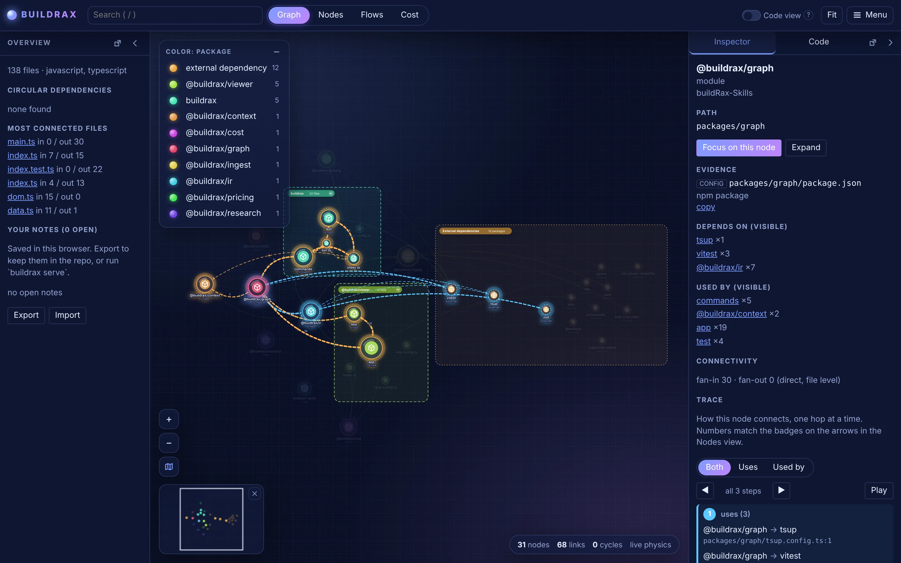
  <br><sub>This repository, scanned by itself: 138 files, zero circular dependencies, in about 1.5 s.</sub>
</p>

> **Status: early and unpublished.** It works end to end and is tested (266 tests, CI on Node 22
> and 24), but the package names are placeholders and there is no npm release yet. Install it
> from source (below).

---

## Demo

Recorded from the real viewer (no mock-ups). Each loops in about 20–25 seconds.

**Explore**: this repository as a map; open packages, see what uses what, focus on one package.

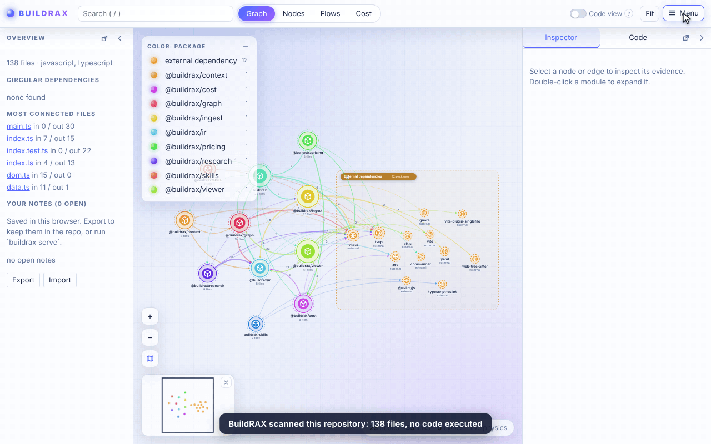

**Trace and read the code**: step through how a file connects, then turn on Code view and click a
file and a database (config lines with secrets masked).

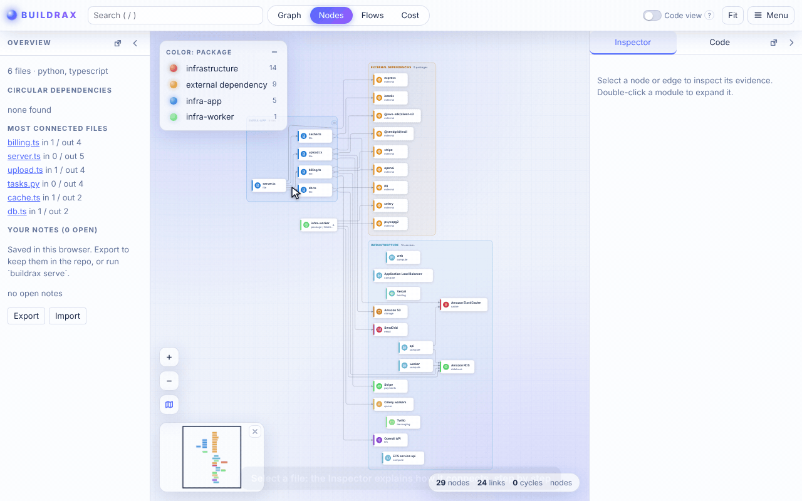

**Flows**: every endpoint across frameworks; follow one to the database and read each step.

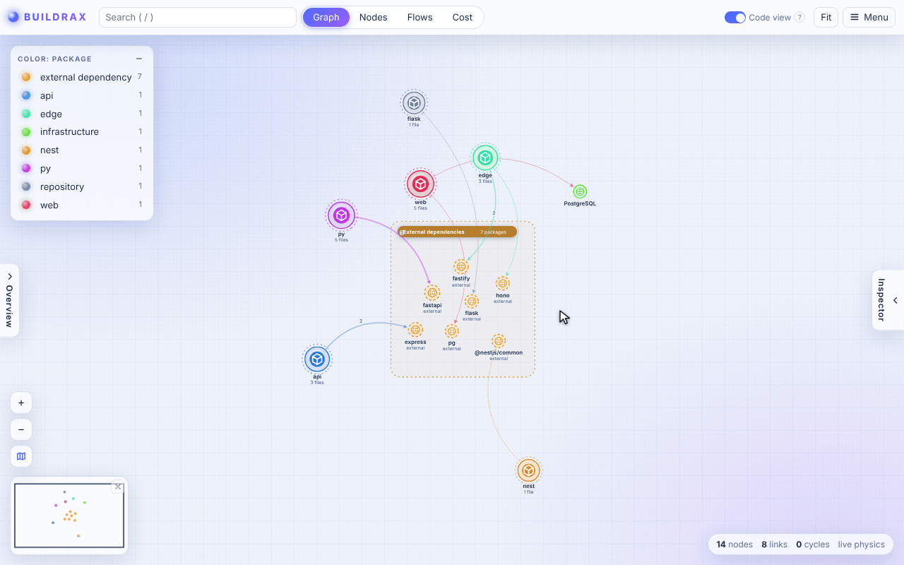

**Cost**: monthly cost per traffic tier, and what happens when an assumption changes.

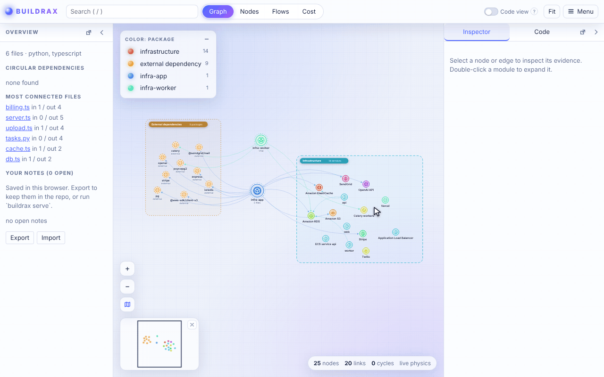

---

## Contents

- [Demo](#demo)
- [Who it is for](#who-it-is-for)
- [Pain points it solves](#pain-points-it-solves): legacy projects and projects you are building now
- [User stories](#user-stories)
- [Feature tour](#feature-tour) (with screenshots)
- [Quick start](#quick-start)
- [Using it with your AI agent](#using-it-with-your-ai-agent)
- [Commands](#commands)
- [How it works](#how-it-works)
- [Privacy and safety](#privacy-and-safety)
- [What it supports](#what-it-supports)
- [Measured, not promised](#measured-not-promised)
- [Known limits](#known-limits)
- [Docs](#docs)

---

## Who it is for

| You are…                                          | What BuildRAX gives you                                                                                                                                                                                                                              |
| ------------------------------------------------- | ---------------------------------------------------------------------------------------------------------------------------------------------------------------------------------------------------------------------------------------------------- |
| **An indie hacker** shipping fast and alone       | A map of what you built last month, so you can pick it back up in minutes. The **Cost** view shows what the app costs to run at 100, 1k, 10k, 100k and 1M users before you launch.                                                                   |
| **A developer** joining or maintaining a codebase | Where things live, what depends on what, what breaks if you change a file (`trace`), and every endpoint with its handler (`routes`), all with `file:line`.                                                                                           |
| **A vibe-coder** building with AI                 | A view of what the AI actually generated: which files talk to the database, which endpoints exist, where the circular imports crept in, and what changed in the last session (`diff`). Code view shows the exact lines behind each arrow.            |
| **A context engineer**                            | Small, deterministic, evidence-linked context packs (`digest`, about 400 tokens; `context "<question>"`, about 4k) instead of dumping files into the prompt. The same input always gives the same output, and your private notes are never included. |
| **A builder or solo technical founder**           | One place for the technical picture an investor, a contractor or a new hire asks about: architecture, infrastructure, monthly cost by traffic tier, end-of-life runtimes and known security advisories for the versions you pin.                     |
| **A team** (the same people, plus reviewers)      | The map rebuilt in CI on every push, with a readable "what changed in the architecture" summary on pull requests and an optional check that fails when a PR introduces a circular dependency.                                                        |

---

## Pain points it solves

### Legacy projects (code you inherited or have not touched in a while)

| Pain                                                                   | How BuildRAX helps                                                                                                                                                   | Where                                          |
| ---------------------------------------------------------------------- | -------------------------------------------------------------------------------------------------------------------------------------------------------------------- | ---------------------------------------------- |
| "Nobody knows how this fits together." The original authors have gone. | A full architecture map from the code itself, not from stale diagrams. Every link points at the import line that creates it.                                         | Graph / Nodes views, `digest`                  |
| "If I change this file, what breaks?"                                  | Transitive impact with `file:line` for each hop, explained one step at a time.                                                                                       | `trace <file> --direction up`, Inspector trace |
| Circular dependencies that make every change risky                     | Found on every scan, highlighted in red, and listed in the summary.                                                                                                  | `scan`, Graph view                             |
| Unknown infrastructure: which databases, caches, queues, paid APIs?    | Detected from compose, Terraform, Kubernetes, platform files and SDK imports, each with evidence and confidence.                                                     | Infrastructure box, `scan`                     |
| Outdated runtimes and vulnerable dependencies                          | Opt-in lookups: OSV.dev advisories for the exact versions in your lockfiles, and end-of-life dates for Node.js, Python, PostgreSQL, Redis, Next.js, Django and more. | `research --online`                            |
| "What does this API endpoint actually touch?"                          | Every endpoint, followed through the code to the databases and services it can reach.                                                                                | `routes`, `flow`, Flows view                   |
| Reading code across dozens of files to answer one question             | Click any box or arrow and read the exact lines behind it in a floating window, without leaving the map.                                                             | Code view (`K`)                                |
| The hosting bill is a mystery                                          | What the declared infrastructure costs per month at each traffic tier, from dated AWS list prices, and where the declared sizes run out.                             | `cost`, Cost view                              |
| Onboarding takes weeks                                                 | A shareable offline viewer plus your own sticky notes and flags on nodes (kept separate from the scanned map, never sent anywhere).                                  | `view`, `serve`, notes                         |

### Projects you are building now

| Pain                                                                            | How BuildRAX helps                                                                                                                                                         | Where                               |
| ------------------------------------------------------------------------------- | -------------------------------------------------------------------------------------------------------------------------------------------------------------------------- | ----------------------------------- |
| AI-generated code drifts: files and dependencies appear that you never designed | See what was added, removed or rewired since the last scan or any commit.                                                                                                  | `diff --since main`, `scan --watch` |
| Your agent burns tokens reading the whole repo                                  | A compact digest and question-specific context packs with `file:line` anchors, measured at about 0.2% and 2% of this repo's source.                                        | `digest`, `context`, agent skill    |
| Architecture erodes quietly between reviews                                     | CI builds the map on every push; PRs get a Markdown architecture diff; new circular dependencies can fail the build.                                                       | `docs/ci.md`                        |
| "Will this scale, and what will it cost?"                                       | Five traffic tiers with low / expected / high monthly cost, bottlenecks per tier (database class, connections, cache memory) and the assumptions that move the total most. | `cost --mode product`, Cost view    |
| Prices you cannot trust                                                         | No invented prices: AWS list prices with source URL and publication date; anything without a price feed is reported as "price needed" with the provider's pricing page.    | `cost`, `.buildrax/prices.json`     |
| Losing track of endpoints across frameworks                                     | One list across Next.js, Express, Fastify, Hono, Koa, NestJS, FastAPI and Flask, with router prefixes resolved across files.                                               | `routes`, Flows view                |
| Keeping the picture current while you code                                      | Incremental rescans (unchanged files are not re-parsed) and a live viewer that offers a refresh when the code changes.                                                     | `scan --watch`, `serve --watch`     |

---

## User stories

Each story is something you can do today, with the command or view that does it.

**Indie hacker**

- As an indie hacker returning to a side project after two months, I want a one-screen overview
  of its packages and hubs, so that I can start a change without rereading everything.
  → `buildrax view --open`, Overview panel ("most connected files").
- As an indie hacker planning a launch, I want to know what the app would cost at 10k and 100k
  users and what breaks first, so that I can price my plan and avoid surprises.
  → `buildrax cost --mode product`, Cost view (bottlenecks per tier).

**Developer**

- As a developer about to refactor `billing.ts`, I want every file that depends on it, hop by
  hop, with the import lines, so that I know what to retest.
  → `buildrax trace src/billing.ts --direction up`, Inspector trace with ◀ ▶.
- As a developer reviewing a pull request, I want the architecture changes in plain words, so
  that I can spot a new dependency or a cycle without reading the whole diff.
  → `buildrax diff --since origin/main --markdown` in CI.

**Vibe-coder**

- As a vibe-coder who let an AI build the backend, I want to see every endpoint and which
  database each one touches, so that I can check it did what I asked.
  → `buildrax routes --reaching database:postgres`, Flows view.
- As a vibe-coder, I want to click an arrow and read the lines that create it, so that I can
  understand generated code without opening ten files.
  → Code view (`K`), then click the arrow.

**Context engineer**

- As a context engineer, I want a bounded, evidence-linked context pack for a question, so that
  my agent answers from facts instead of guesses, and spends a few thousand tokens instead of
  hundreds of thousands.
  → `buildrax context "how does checkout talk to Stripe" --budget 3000`.
- As a context engineer, I want the same repository to always produce the same IDs and the same
  digest, so that prompts and caches are stable across runs.
  → deterministic IDs and scans (checked by tests).

**Builder / solo technical founder**

- As a solo founder, I want a list of end-of-life runtimes and known advisories for the exact
  versions we run, so that I can fix real risks before a security questionnaire asks.
  → `buildrax research` (shows the plan), then `buildrax research --online` once you agree.
- As a founder, I want to show a contractor how the system fits together without sending them a
  slide deck, so that they are productive on day one.
  → `buildrax view` produces one offline HTML file (it contains your source; use `--no-source`
  to leave the code out).

**Team**

- As a team lead, I want the architecture map rebuilt on every push and attached to the build,
  so that it is never stale and never committed.
  → the `architecture` job in `.github/workflows/ci.yml`; recipe in `docs/ci.md`.

---

## Feature tour

### Graph view: explore

Animated orbs, live physics and dotted **segment boxes** around every expanded package or folder.
Click a node to light up everything upstream (orange) and downstream (blue); cycles pulse red.
Colour by package, kind, language or connectivity. Drag, pin, focus (`F`), collapse.
_(See the screenshot at the top.)_

### Nodes view: understand

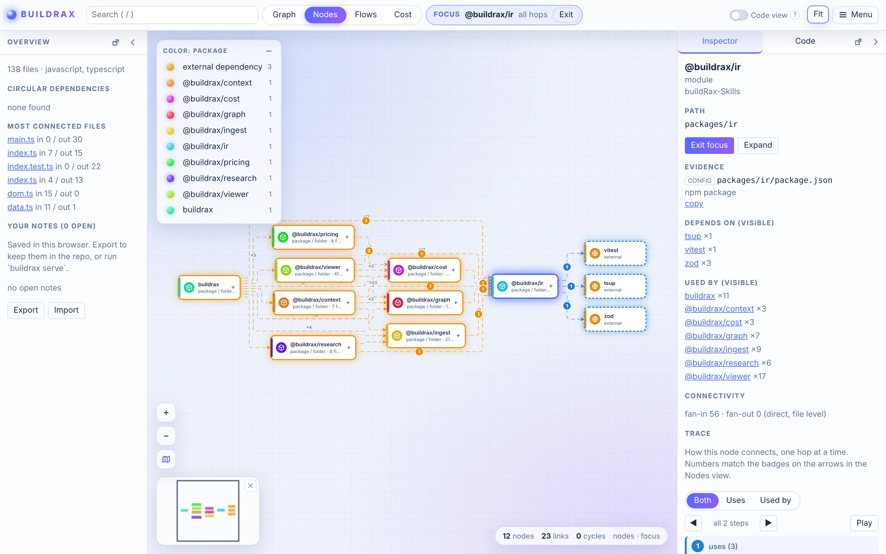

A structured diagram: cards in left-to-right layers, frames for services and folders,
right-angled arrows routed around the cards. **Focus** on a node to see only what connects to
it, one column per hop. Above: everything in this repo that depends on `@buildrax/ir`.

### Step-by-step trace: explain

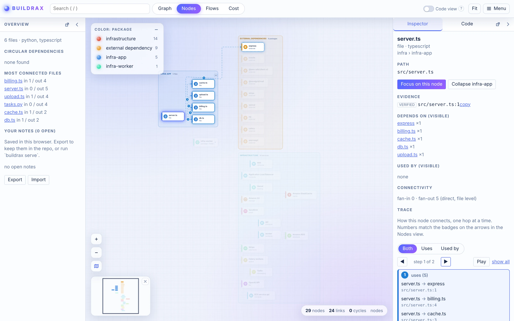

Select a node and the Inspector explains how it connects, one hop at a time ("uses", "used by"),
with the `file:line` of each link. Arrows carry matching step numbers. Step with ◀ ▶ or press
**Play**.

### Flows view: follow a request

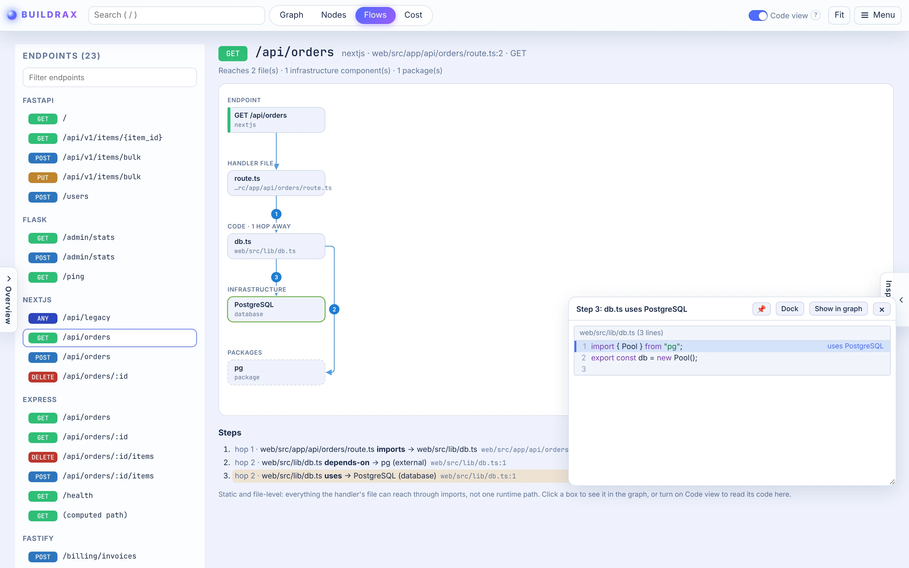

Every endpoint the scan found, grouped by framework. Pick one to see what it reaches, lane by
lane: endpoint → handler file → code by hop → infrastructure → packages, with numbered steps.
The same is available in the terminal: `buildrax flow "GET /api/orders"`. To go one level
deeper, select a file and open **Functions** in the inspector, or run
`buildrax fn web/src/app/api/orders/route.ts`: each function with the routes it handles, the
tables and queues it touches, what it calls and who calls it.

### Why is it built this way?

Select anything and the inspector's **Why** section quotes what the repository already says about
it: decision records (ADRs), the README or docs sections that name it, comments that explain a
choice, and the commit messages behind its changes. Each is labelled by where it came from. In the
terminal: `buildrax why web/src/lib/db.ts`, and `buildrax decisions` for the decision log.
Nothing is generated: it is quoted, and tied only by exact names and paths.

### Design view: the system on one page

`buildrax design` turns the scan into a system-design view: C4 context, containers and
components (`--level 3`), the system-design concepts found in the code with their evidence (an
HTTP API, a cache used cache-aside, a queue with workers, schema migrations, retries, tracing…),
and a non-functional scorecard (reliability, scalability, performance, security, observability,
maintainability, data) that says what is present, absent or risky. Counts, not grades; every line
says where it came from. See [docs/design.md](docs/design.md).

### Code view: read the code behind any box or arrow

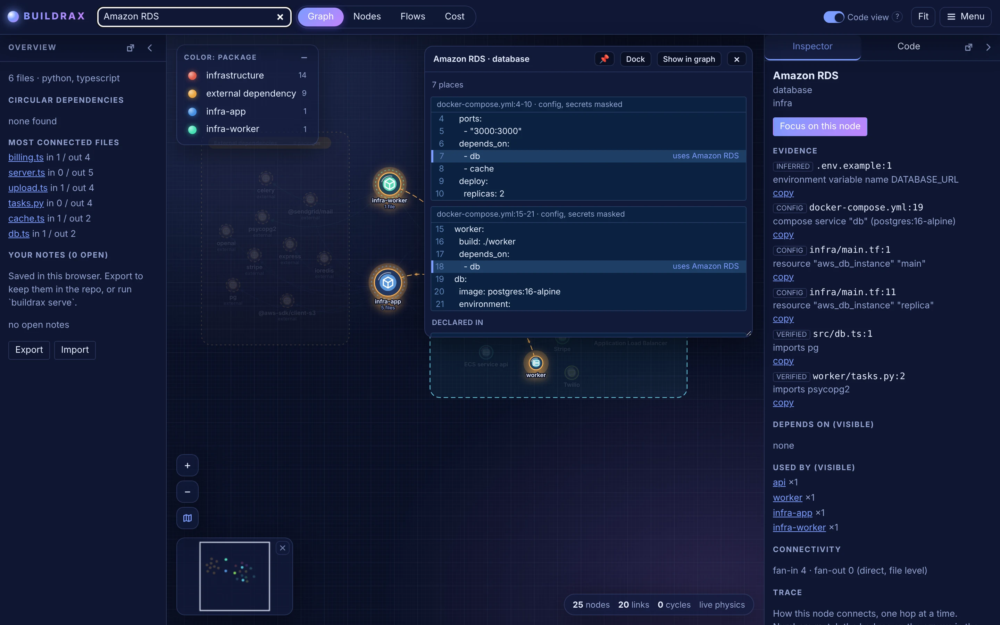

One switch in the top bar (`K`, off by default, hover its `?` for what it does) for every view.
Click a file to read it with its links marked; click an arrow for the lines that create it; click
a database to see where the code uses it and where compose, Terraform or Kubernetes declares it.
Config files show only the lines near the evidence, with secret-looking values masked. 📌 **Pin**
up to three windows to compare, **Dock** into the Code tab or ⧉ **Pop out** again.

### Cost view: what will this cost to run?

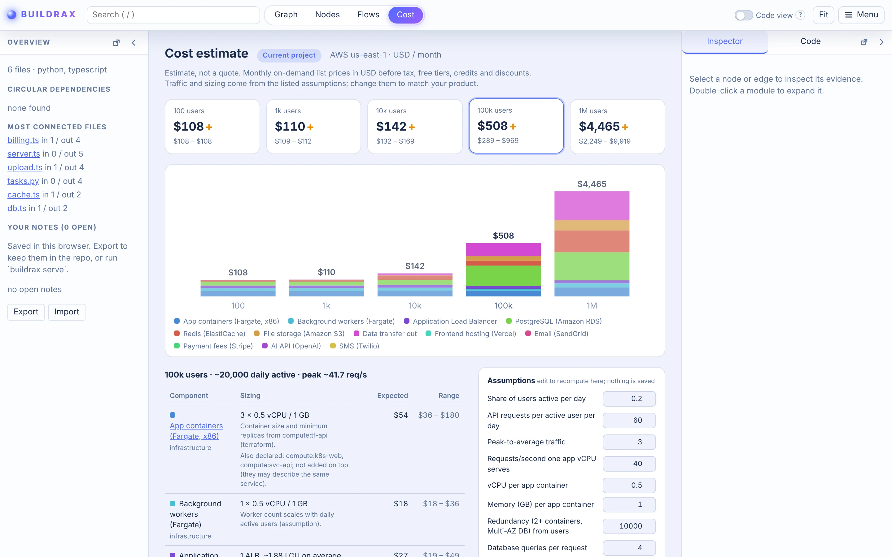

Monthly cost per traffic tier (100 → 1M users) for what the repo declares, or for a hypothetical
product stack you choose. Low / expected / high ranges, bottlenecks per tier, the assumptions
that move the total most (editable in the page), and the source and date of every price. Items
without a price feed are shown as "price needed", never guessed. _Estimates, not quotes._

### And also

- **Research** (opt-in): OSV.dev advisories for pinned versions, endoflife.date support dates,
  registry facts; every finding carries its source and date.
- **Diff and CI**: `buildrax diff --since main`, a Markdown summary for job summaries and PR
  comments, and a cycle gate (`--fail-on-new-cycles`).
- **Live**: `scan --watch`, `serve --watch` with a "the code changed, refresh?" banner.
- **Notes**: sticky notes and flags on any node or link, kept apart from the scanned map.
- Light / dark / auto themes, collapsible and detachable panels, minimap, keyboard shortcuts,
  reduced-motion support, shareable URLs.

---

## Quick start

Requires Node.js 22 or newer and pnpm.

```bash
git clone https://github.com/chetanya1998/buildRax-Skills.git
cd buildRax-Skills
pnpm install && pnpm build
alias buildrax="node $PWD/packages/cli/dist/bin.js"   # until it is published
```

Point it at any repository:

```bash
buildrax scan path/to/your-repo
```

```bash
buildrax view path/to/your-repo --open
```

Or try the included examples: `fixtures/sample-monorepo` (TypeScript and Python packages with a
deliberate circular import), `fixtures/infra-app` (compose, Terraform, Kubernetes, SDKs) and
`fixtures/flows-app` (one small app per web framework).

Useful next steps:

```bash
buildrax routes path/to/your-repo
```

```bash
buildrax cost path/to/your-repo
```

```bash
buildrax serve path/to/your-repo --watch --open
```

---

## Using it with your AI agent

Install the skill (instructions only; all logic stays in the CLI):

```bash
buildrax install-skill --target claude
```

Targets: `claude`, `codex`, `antigravity` or `all`; `--scope user` installs it for every project.
Then ask in plain words, for example:

- "Give me an overview of this repo's architecture."
- "What breaks if I change `src/billing.ts`?"
- "Which endpoints write to the database?"
- "What changed in the architecture since `main`?"
- "What would this cost at 100k users? Ask me about the stack first."
- "Are we running anything end-of-life?" (the agent shows the research plan and asks before going
  online)

The skill tells the agent to scan first, use `digest` / `context` instead of reading the whole
repo, cite `file:line`, say how sure each claim is, never invent nodes or prices, and ask before
any network lookup.

---

## Commands

| Command                                                    | What it does                                                                                        |
| ---------------------------------------------------------- | --------------------------------------------------------------------------------------------------- |
| `scan [--watch] [--no-cache]`                              | Static, incremental scan to `.buildrax/model.json`. No LLM tokens, no code execution.               |
| `digest` / `context "<question>" [--budget N]`             | Compact, token-bounded context for agents (notes excluded).                                         |
| `trace <target> [--direction up\|down]`                    | Transitive dependencies or change impact, with `file:line`.                                         |
| `routes [--reaching X]` / `flow "<METHOD> /path"`          | Endpoints the scan found; follow one to the code, services and databases it reaches.                |
| `diff [--since <ref>] [--markdown] [--fail-on-new-cycles]` | Architecture changes since the last scan, a commit, or a saved model.                               |
| `view [--no-source]` / `serve [--watch]`                   | The viewer: one offline HTML file, or a local server that saves your notes and refreshes on change. |
| `notes`                                                    | List your sticky notes and flags.                                                                   |
| `research [--online]`                                      | Advisories, end-of-life dates and registry facts. Shows the plan unless `--online`.                 |
| `cost [--mode current\|product] [--online]`                | Monthly cost per traffic tier from dated AWS list prices (`docs/cost.md`).                          |
| `install-skill`                                            | Install the agent skill for Claude Code, Codex or Antigravity.                                      |

Most commands take `--json` for scripts and agents.

---

## How it works

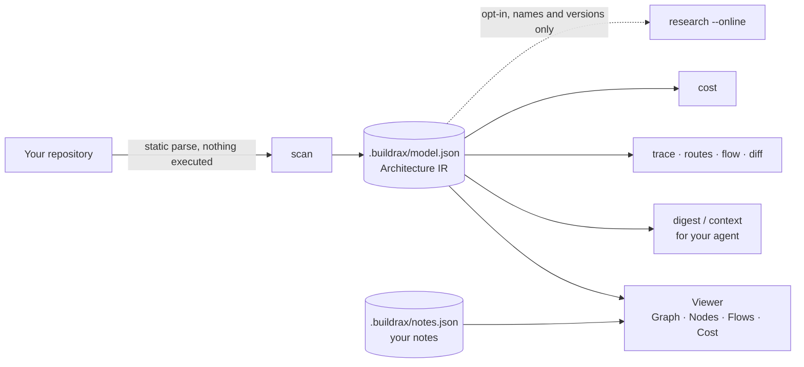

1. **Scan**: tree-sitter parses TypeScript, JavaScript and Python files (imports, endpoints);
   manifests, lockfiles and deploy files are read as data. Unchanged files are served from a
   content-hashed cache.
2. **Model**: a versioned Architecture IR (`docs/schema.md`) with deterministic IDs. Every node
   and edge carries evidence (`verified`, `config`, `inferred` or `unresolved`).
3. **Use**: the viewer, the CLI and the agent skill all read the same model. Notes live in a
   separate file and never change the model.

---

## Privacy and safety

- **Local by default.** `scan`, `view`, `digest`, `context`, `trace`, `routes`, `flow`, `diff`
  and `cost` (without `--online`) make no network requests.
- **Never runs your code**, never calls an LLM while scanning.
- **Opt-in lookups** (`research --online`, `cost --online`) first show exactly what would be sent,
  then send only public package names, versions and product names to allowlisted hosts.
- **Secrets**: a real `.env` is never opened. Config-file excerpts in the viewer are limited to
  lines next to recorded evidence, with secret-looking values masked.
- **Your notes** are never sent anywhere and never included in agent context.
- **Optional cloud credentials** (for AWS price lookups) are read from the environment for that
  run only, never stored, and redacted from errors.
- `view.html` contains your source code (for the Code tab and Code view). Share it only if you
  mean to, or build it with `--no-source`.

Details: `docs/privacy.md`.

---

## What it supports

| Area           | Today                                                                                                                                                                                                                       |
| -------------- | --------------------------------------------------------------------------------------------------------------------------------------------------------------------------------------------------------------------------- |
| Languages      | TypeScript, JavaScript (ESM and CommonJS), Python; tsconfig/jsconfig `paths` and `baseUrl` aliases                                                                                                                          |
| Data flow      | Reads and writes to databases and caches, queue publish/consume (Prisma, SQL, Drizzle, Supabase, TypeORM, MongoDB, Redis, BullMQ, Kafka, SQS, RabbitMQ, Django ORM, SQLAlchemy, Celery), followed through queues to workers |
| Data models    | Prisma, TypeORM, Drizzle, Mongoose, Django and SQLAlchemy models as entities with fields and relations, linked to the code that reads or writes them                                                                        |
| Endpoints      | Next.js (app and pages routers), Express, Fastify, Hono, Koa, NestJS, FastAPI, Flask (router prefixes followed across files)                                                                                                |
| Infrastructure | docker-compose, Dockerfiles, Terraform (AWS, Google Cloud, Azure resources), Kubernetes, Vercel, Netlify, Fly, Render, Procfile, Serverless, Prisma, SDK imports, `.env.example` names                                      |
| Lockfiles      | npm, pnpm, yarn, poetry, uv, requirements (exact pins), Pipfile.lock                                                                                                                                                        |
| Research       | OSV.dev, endoflife.date, npm and PyPI registries                                                                                                                                                                            |
| Cost           | AWS: Fargate, RDS (PostgreSQL / MySQL), ElastiCache (Redis / Valkey), S3, ALB, data transfer, SES; SaaS prices you record with source and date                                                                              |
| Agents         | Claude Code, Codex, Antigravity (skill install paths not yet verified against each vendor's docs)                                                                                                                           |

---

## Measured, not promised

Measured on this repository (138 source files, fixtures excluded) on the build machine. Token
figures are estimates (characters ÷ 4).

| What                                    | Result                      |
| --------------------------------------- | --------------------------- |
| Full scan                               | about 1.5 s                 |
| Rescan with nothing changed             | about 0.1 s                 |
| Raw source                              | about 198,000 tokens        |
| `digest`                                | about 420 tokens            |
| `context "<question>"` (default budget) | about 4,000 tokens          |
| Viewer file                             | about 1.8 MB, works offline |

Your numbers will differ with repository size and machine.

---

## Known limits

- Import-level and file-level today: no function-level call graph yet, so `flow` shows
  everything the handler's file can reach, not a single runtime path. Reads, writes and queue
  hops are detected from client calls; dynamic table or queue names are not resolved.
- Static analysis cannot see dynamic imports, dependency injection or runtime wiring; a missing
  link is not proof of no dependency. Paths built at runtime are listed as computed, never guessed.
- Cost: AWS only, on-demand list prices; capacity comes from editable assumptions, not
  measurements.
- Secret masking in config excerpts is pattern-based; review before sharing a viewer built from
  config files that hold secrets under unusual names.
- Very large graphs (many hundreds of nodes on screen at once) have not been benchmarked; collapse
  packages to stay responsive.
- Package names (`buildrax`, `@buildrax/*`) are placeholders and unpublished.

---

## Docs

| Doc               | About                                                       |
| ----------------- | ----------------------------------------------------------- |
| `docs/roadmap.md` | What is done and what comes next                            |
| `docs/schema.md`  | The Architecture IR and research file formats               |
| `docs/cost.md`    | The cost model, price sources and `prices.json`             |
| `docs/ci.md`      | The architecture map as a CI artifact, PR diffs, cycle gate |
| `docs/privacy.md` | What stays local, what is sent, how secrets are handled     |
| `docs/agents.md`  | Agent skill installation                                    |
| `docs/scope.md`   | Scope and open decisions                                    |

## Contributing

```bash
pnpm install && pnpm lint && pnpm typecheck && pnpm test && pnpm build
```

Project rules (determinism, evidence on every node, no invented prices, tests with every
feature) are in `CLAUDE.md`.

## License

MIT, see `LICENSE`.
